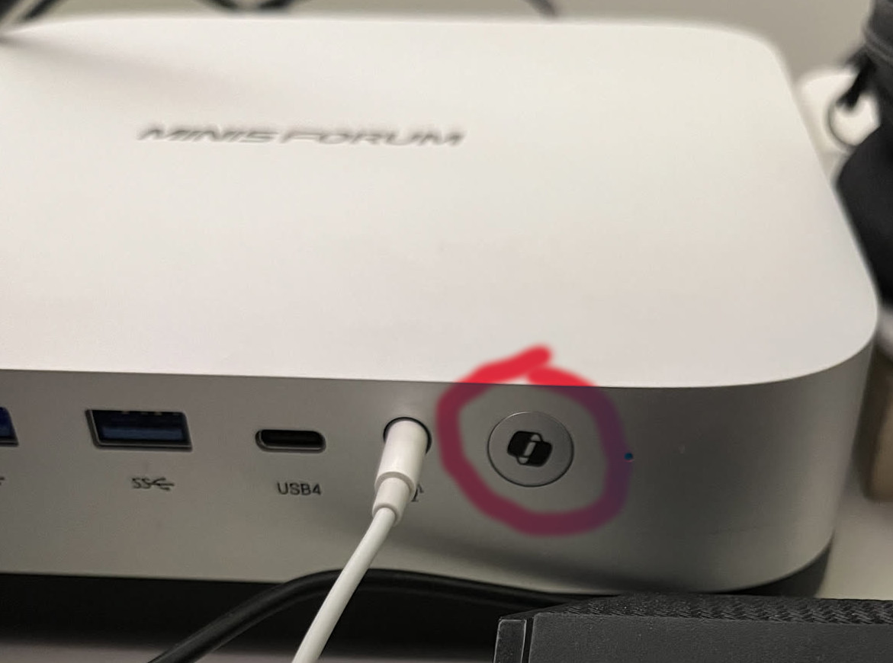
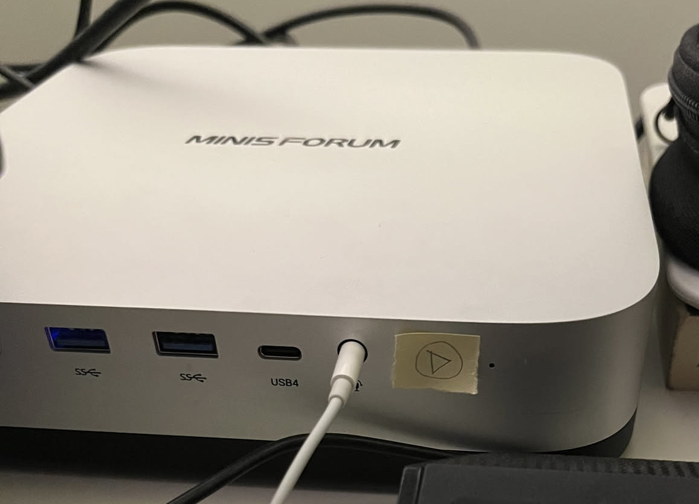

## The Minisforum AI X1 Pro has a Copilot button
A few months ago I bought a new mini-pc: the Minisforum AI X1 Pro.  
It's a great machine and does exactly what I need. However, it comes pre-packaged with Windows, like most mini-pcs do. But in this case it's even more than that: it comes pre-packaged with Copilot. I mean there literally is a Copilot button on the physical device, part of Microsoft's broader push to put dedicated Copilot controls on Windows hardware. And so, understandably, Minisforum adds it to its mini-pcs as well.  



However, I had no intention of keeping Windows on this mini-pc so soon enough I had Arch Linux installed on it, and left behind any semblance of Windows.  
All semblance except for the Copilot button, that was gonna be there forever, with its physical useless button. But at least I would have it my own way. A few weeks prior to buying the mini-pc I had watched a few reviews about this machine before committing on the purchase. One of the reviews I had come across was from [Riccardo Palombo](https://www.youtube.com/watch?v=zMaDsIIDf_M), where he was floating the idea that the Copilot button could be remapped. I don't know much about hardware, and so I didn't really understand how that was possible but the idea kept floating in my head.  
And then a few weeks ago I was listening to [an episode of a podcast](https://www.youtube.com/watch?v=Nq36r7OZEzQ) where one of the hosts was showing his reluctance to buying a Windows pc to install Linux on it, because he would be paying extra for all the Copilot parts and Microsoft deals with that company. I don't exactly know what arrangement Minisforum has with Microsoft, or whether the button materially affected the price I paid. But it was already taking up space on my machine, so I wanted to make it useful.  


## The Copilot button... but why?
To begin with, I wanted to take a moment of silence for the Copilot button. I feel bad for the Copilot button. It must feel terrible to have your only competition be the power button, especially when all you have to offer is opening Copilot, when everything goes well.  
I would be so curious to understand who could have possibly come up with the idea of adding a button to open Copilot on the device. Assuming in an alternate universe I was of the opinion that using Copilot was a good idea, why would I ever need a button for it? How is that any better than any combination of keys that maps to opening Copilot rather than having a button for it?  
A mini-pc is not even meant to be placed like a laptop near you. So it's not even clear that people would have easy access to the button while using the mini-pc even if they wanted to. And it probably costs money to do this: you might have to redesign some things, repurpose other things, add material, etc. which makes the product more expensive. Maybe in a few years everyone will be using the button and this comment will have aged very poorly, but until then: Why??? Why did you have to add this button Microsoft?  


## What to remap the Copilot button to
Like I said earlier, I consider a button on the device of a mini-pc fairly useless, because there is no world where using the keyboard would be worse than using a button on the mini-pc (purely because of placement and ergonomics). And in the few instances where the keyboard doesn't work you probably are looking to restart your computer to solve the issue, which is literally what the power button does, so no use for Copilot there. But as I thought more I came up with a scenario where a second button might be useful: sometimes I find myself with two computers on at the same time. Maybe I am working on my laptop and this mini-pc. So I use a KVM switch to re-direct the HDMI for the monitor, and the USBs for the keyboard and the mouse. In that scenario, if I am on my laptop it might be annoying to have to move to my mini-pc just to do a quick action and then come back to my laptop. So this would be a case where accessing something on the mini-pc physical device might make sense (because my keyboard is taken by my other device).  
And as I thought about it I came to the conclusion that for me that quick action is media playback. Maybe I am listening to some music on the mini-pc when I have to get on a call on my laptop, and have to quickly stop the music. It would be useful under this scenario to have the button function as media play button, to avoid having to move back and forth between the two machines just to stop some music.  
Before jumping to implementing, I considered a few options on other functionalities to remap the Copilot button to. I had a few options in mind (including playing the [Windows error sound](https://www.youtube.com/watch?v=u4NNS9ebvyE) whenever the button is pressed, or launching a "Copilot is thinking..." spinner that never ends) but I ended up settling for the media playback.  


## Remapping the Copilot button
I didn't really know where to start because when I clicked the button while on an empty desktop nothing happened. So I wasn't really thinking about this much anymore, when a few days ago, while working in Neovim, I accidentally pressed the Copilot button, and I saw a strange result appear on the screen. While on an empty desktop screen nothing had happened, this time a `<S-D-F23>` cryptic set of letters appeared on screen. So something was receiving this signal, but it just wasn't doing anything.  
If I could capture the signal from `<S-D-F23>`, it should be easy to remap it to something else.
After some googling (more like LLMing) I learned that this notation just meant S=Shift, D=Super, and F23 (I always thought fn keys stopped at F12, but I guess Microsoft found another 12 somewhere).  
So all I needed to do was remap Super + Shift + F23 to the action I wanted. In my Lua-based Hyprland config this was easily done with:  
```
hl.bind(
  "SUPER + SHIFT + F23", 
  hl.dsp.exec_cmd("playerctl play-pause"), 
  { locked = true }
)
```  
And there I had it, complete with a beautiful visual signal on the button's new functionality:  



This adventure was just as useless as it was satisfying.  
Microsoft had decided that this button should open Copilot. My Hyprland configuration and drawing skills disagree. It's always exhilarating to delve into Microsoft's marketing choices because they are always able to come up with something that no other sensible organization would even think of.  

If you enjoyed this, you can [subscribe on Substack](https://substack.com/@openeverything) or [subscribe via RSS](https://smarmelling.com/feed.xml).
